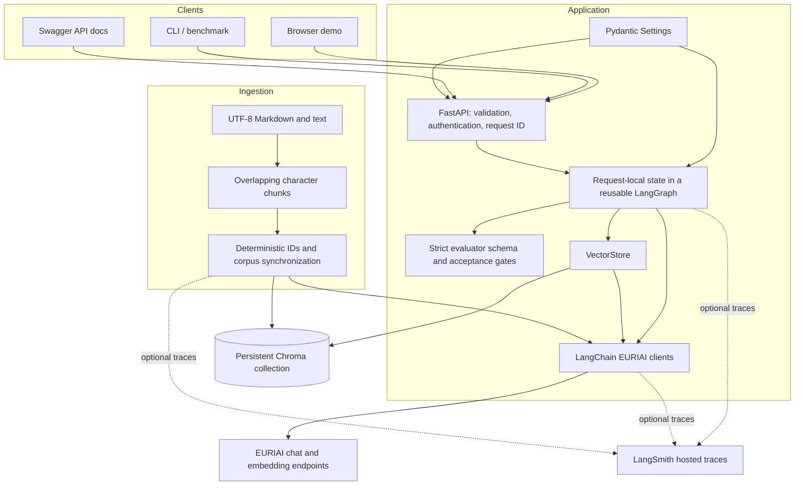
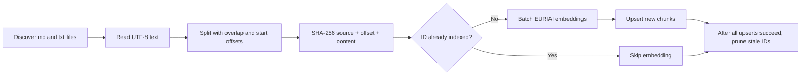
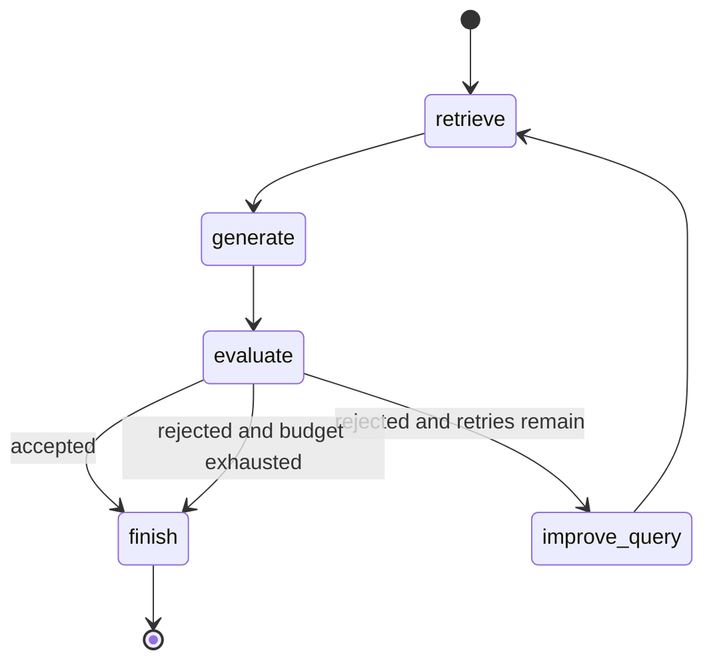
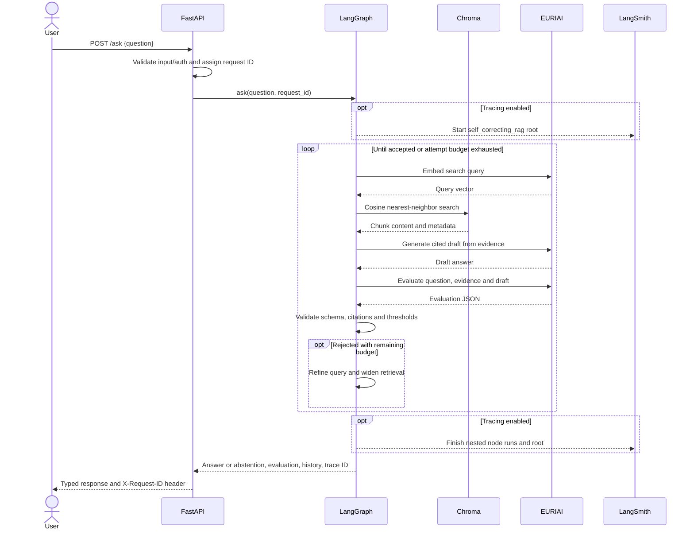

# Architecture: Self-Correcting RAG Agent

## 1. Purpose and boundaries

The system answers questions from a managed local document corpus. It evaluates evidence relevance, answer grounding, hallucination risk, and completeness, then automatically retrieves again when validation fails. A bounded graph guarantees that quality failures end in either an accepted answer or an explicit abstention.

The application uses EURIAI for embeddings and chat completions, Chroma for local vector persistence, LangGraph for control flow, FastAPI for HTTP access, and LangSmith for optional observability. The bundled policies describe a fictional company. No internet search or outside factual knowledge is used to fill gaps.

## 2. Component architecture



| Module | Responsibility | Dependencies |
|---|---|---|
| `app/config.py` | Load/validate settings and normalize paths | Pydantic Settings |
| `app/provider.py` | Authenticate to EURIAI, validate response shape, retry transient errors | ChatOpenAI, OpenAIEmbeddings, HTTPX, LangSmith |
| `app/store.py` | Query explicit embeddings, persist cosine index, check embedding compatibility | Chroma, provider protocol |
| `app/ingest.py` | Discover documents, split, hash, embed, upsert, prune stale chunks | Text splitter, vector store |
| `app/schemas.py` | Strict evaluation and public response models | Pydantic |
| `app/rag.py` | Request state, graph nodes, validation, correction, finalization | LangGraph, provider/retriever protocols |
| `app/observability.py` | Per-request tracing configuration and client caching | LangSmith |
| `app/api.py` | HTTP boundary, optional shared key, readiness and service errors | FastAPI, cached agent |
| `app/static/index.html` | Display answer, draft history and source evidence | Browser fetch API |

The workflow accepts provider and retriever dependencies. Offline tests exercise the actual graph with deterministic fakes, while index tests use a real persistent Chroma collection and local synthetic embeddings.

The EURIAI provider configures `ChatOpenAI` with the selected model, EURIAI key/base URL, and temperature 0.1. `OpenAIEmbeddings` uses that same key/base URL with `check_embedding_ctx_length=False` and `encoding_format=float`. The former sends original text without OpenAI-specific tokenization; the latter avoids base64 defaults. An HTTP response hook checks vector count, ordering, dimensions and finite numeric values before SDK coercion. The SDK's own retries are disabled; the application owns the bounded retry loop and retries only the failed embedding batch. This adapter change does not prove that EURIAI service-side HTTP 500 errors are resolved; `scripts/check_provider.py` isolates chat, one-text embeddings and batch embeddings without writing the index.

## 3. Ingestion and index lifecycle



1. Resolve `DATA_DIR` against the project root and require a non-empty text corpus. Files are processed in sorted order. Symlinked files must resolve inside the corpus root.
2. Split with `RecursiveCharacterTextSplitter`, default 900 characters and 150 characters of overlap. Preserve the relative filename and `start_index`.
3. Derive each chunk ID from `SHA256(source | start_index | content)`. Unchanged source chunks retain their identity.
4. Open the Chroma collection with cosine distance and an embedding signature derived from the EURIAI base URL and embedding model. A mismatched or missing signature requires a new collection name.
5. Compare desired IDs with existing IDs. Embed only new IDs, in batches of up to 32 by default, and upsert them.
6. After all new batches succeed, delete obsolete IDs in batches. The selected collection is owned by this corpus and should not contain unrelated application data.

Chroma maintains vectors and metadata on disk; a separately managed manifest is not needed. An unchanged second ingestion performs no document embedding calls. Editing, removing, or rechunking a file results in new IDs and pruning of obsolete IDs.

Synchronization is **not atomic across batches**. An error after some successful upserts can leave a mixture of old and new chunks. Existing chunks are retained until all upserts succeed, and a subsequent successful run reconciles the collection. Stop the API while ingesting to avoid serving an intermediate index. An empty corpus does not implicitly delete everything.

## 4. Graph state and control flow



| State field | Meaning |
|---|---|
| `question` | Original validated question; never rewritten |
| `search_query` | Current retrieval query |
| `documents` | Deduplicated and context-budgeted evidence for the current attempt |
| `answer` | Current unverified draft, then final answer/abstention |
| `evaluation` | Strict evaluation result, or conservative fallback on parse failure |
| `attempts` | Number of retrieval cycles already started |
| `retrieval_k` | Requested number of nearest chunks for the current cycle |
| `accepted` | Deterministic result of all acceptance gates |
| `history` | Append-only snapshots of completed attempts |
| `generation_error` | Explains a skipped generation when retrieval returned no evidence |

**Retrieve:** increment the attempt count, request `min(TOP_K × attempt, MAX_RETRIEVAL_K)` chunks, then cap by collection size. Deduplicate by chunk ID. Apply `MAX_CONTEXT_CHARS` to the total retrieved text, truncating the final included chunk when necessary. Assign `[S1]`, `[S2]`, etc. after filtering. Those exact evidence excerpts are used by generator, evaluator, history and API sources.

**Generate:** make a fresh EURIAI chat call. The system instruction restricts answers to evidence, requires factual citations, and tells the model to treat embedded instructions as untrusted. The JSON user payload contains the original question, evidence and previous evaluation. Empty evidence skips generation and leads to rejection.

**Evaluate:** make a distinct chat call, optionally with `EVALUATOR_MODEL`. The judge checks evidence coverage, every claim, citation support, contradictions, and every part of the original question. Parse only strict JSON, optionally inside a single Markdown JSON fence. Do not coerce types, clamp scores, ignore duplicate keys, or silently accept missing fields.

**Improve query:** combine the original question with the judge's proposed search focus. Do not append arbitrary failure narratives as factual search terms. The next retrieval also expands `k`, so retries with an unchanged query still widen the candidate evidence set until the cap is reached.

**Finish:** preserve an accepted answer. If rejection persists, replace the user-facing answer with a fixed abstention while retaining rejected drafts and evidence in history.

## 5. Evaluation contract and acceptance logic

The evaluator must return exactly these fields:

```json
{
  "retrieval_relevance": 5,
  "grounding": 5,
  "hallucination_risk": 1,
  "completeness": 5,
  "retry_required": false,
  "reason": "Every requested policy detail is supported by the cited evidence.",
  "improved_query": "annual leave allowance carry-forward deadline",
  "missing_information": [],
  "unsupported_claims": []
}
```

This is an illustrative schema example, not a measured model response. Scores are strict integers from 1 through 5. Risk increases with the hallucination score; quality increases with the other three scores.

```text
accept = nonempty_answer
         AND nonempty_evidence
         AND at_least_one_valid_citation
         AND no_unknown_citation_ids
         AND retrieval_relevance >= configured_minimum
         AND grounding >= configured_minimum
         AND hallucination_risk <= configured_maximum
         AND completeness >= configured_minimum
         AND retry_required is false
         AND missing_information is empty
         AND unsupported_claims is empty
```

A schema/JSON error produces conservative scores `(1, 1, 5, 1)` and `retry_required=true`. The graph retries if the budget permits. A positive judge score cannot override missing evidence or invalid citation IDs. A judge recommendation not to retry also cannot override a failing quality threshold: a failed answer still receives another attempt while budget remains.

Citation validation only establishes that IDs exist in the supplied evidence. Whether each citation entails its associated claim remains an LLM evaluation task. `accepted=true` therefore means the configured checks passed, not mathematical proof of factual correctness.

## 6. Request sequence and observability



`trace_context` explicitly enables/disables tracing and assigns the project, cached LangSmith client, tags and request metadata. The root `self_correcting_rag` span contains graph and node spans. `euriai.chat` is a chain span with native `ChatOpenAI` LLM children, avoiding duplicate LLM usage accounting; `euriai.embed` is an embedding span. The trace ID in the response is the root run ID. Nested trace creation and parent linkage are tested with a mocked upload client; successful upload to a hosted workspace must be verified live. Native model error traces can contain provider error messages, so use a private tracing workspace and inspect traces before sharing them.

Trace inputs and outputs intentionally include questions, evidence, drafts and evaluations to make failures inspectable. Credentials remain in settings/provider clients and are not explicit traced parameters; provider objects use their default opaque representation. Normal API logs contain request IDs, status, attempt counts, durations and exception class names, not raw credentials, arbitrary provider bodies or full user questions.

## 7. Error handling, bounds and concurrency

| Failure | Handling |
|---|---|
| Model judgment or evidence fails quality checks | Record attempt, retry within budget, then abstain |
| Malformed evaluator JSON | Fail closed with conservative scores; retry within budget |
| Empty indexed collection | 503 with ingestion guidance |
| Empty retriever result | Skip generation/judgment, record failure and retry |
| Network timeout / HTTP 408, 429, 500, 502, 503, 504 | Bounded exponential backoff; bounded numeric `Retry-After` honored |
| HTTP 400/401/403/404 | Fail immediately; no automatic retry for permanent request errors |
| Invalid provider response shape / truncated completion | Sanitized provider error, surfaced as 502 |
| Unexpected application error | 500 with request reference; log exception type |

Quality retries and provider retries have separate settings and meanings. With `MAX_RETRIES=2`, the graph runs at most three cycles. Recursion limits are derived from that budget, including the maximum supported five retries. Every HTTP operation has configured phase timeouts and a bounded retry count, but the application does not enforce a hard wall-clock deadline across the whole graph.

FastAPI synchronous handlers run in its thread pool. One lazily created agent and HTTP client are reused, protected by a lock during initialization. Every `ask` invocation gets fresh graph state and history; there is no shared conversation memory or checkpoint persistence. The HTTP client is closed on application shutdown. Concurrent API requests can still increase provider quota pressure; there is no application-level admission queue or rate limiter.

## 8. Deployment and data boundaries

```mermaid
flowchart LR
    Browser[Local browser / client] --> Port[Host 127.0.0.1:8000]
    subgraph Docker container, non-root user
        Port --> API[One Uvicorn worker]
        API --> DB[Embedded Chroma]
    end
    Volume[(Named index volume)] --- DB
    Corpus[Read-only host data directory] --> Ingest[One-off ingestion command]
    Ingest --> Volume
    API --> EURI[EURIAI over HTTPS]
    API -. optional .-> Smith[LangSmith over HTTPS]
```

The host corpus is mounted read-only; the Chroma volume is writable and survives container replacement. A liveness check exercises `/health`. `/ready` checks local index readiness separately. Ingestion is a one-off command before serving. For multiple workers or larger deployments, replace embedded persistence with a server vector database and add proper access control, TLS termination, rate limiting, request deadlines and index version rollouts.

The shared app `API_KEY` is optional for local demonstration and protects `/ask` and `/ready` when configured. It is not multi-user authentication. `/health`, the browser interface and API docs remain public. The UI renders provider text with `textContent` rather than interpreting model output as HTML.

## 9. Validation strategy and known tradeoffs

- Workflow tests exercise first-attempt success, correction recovery, exhaustion, each quality gate, malformed judgments, invalid citations, maximum retries, empty evidence and request isolation.
- HTTP tests cover optional auth, question validation, response schema, request IDs and sanitized errors.
- Provider tests use HTTPX mock transports to verify endpoint/authentication shape, retry limits, permanent failures and invalid embeddings.
- Ingestion tests run real local Chroma operations with synthetic vectors, proving idempotency, edit/delete reconciliation and preservation of old chunks on embedding failure.
- Tracing tests inspect nested root/node runs without sending data to a hosted service.
- The live corpus benchmark checks known policy facts and abstention expectations independently of evaluator scores. Its small keyword-based checks need human review for semantic accuracy.

Key tradeoffs: an LLM judge adds latency/cost and may share the generator's blind spots; broader retrieval can add irrelevant evidence; character budgets approximate prompt size rather than enforcing a tokenizer-specific limit; query anchoring limits but does not eliminate semantic drift; prompt injection remains possible; documents can be wrong or stale; retries cannot manufacture missing evidence. Explicit abstention is the intended outcome when validation cannot be satisfied.
