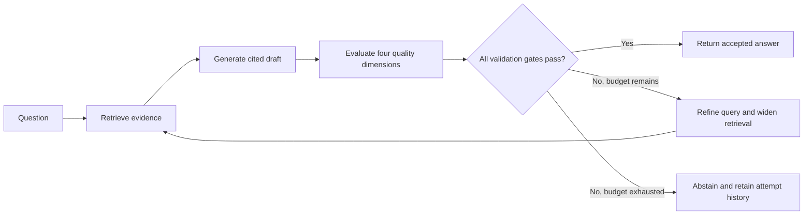

# Self-Correcting RAG Agent

A retrieval-augmented question-answering agent that checks its own answers, retries when validation fails, and abstains when it cannot produce a verified, complete answer. Built with **EURIAI, LangGraph, ChromaDB, FastAPI, and LangSmith**.

The included knowledge base contains five fictional ChaiTech policies. The browser demo exposes the evidence, draft answers, quality scores, and correction history so the system's decisions can be explained and reviewed.

## Assignment requirements

| Requirement | Implementation | Review evidence |
|---|---|---|
| Retrieve relevant knowledge | EURIAI embeddings and persistent cosine search in Chroma | `app/store.py`; per-attempt sources and search query |
| Check retrieval relevance | Evaluator scores how well retrieved evidence answers the original question | `evaluation.retrieval_relevance` |
| Check answer grounding | Judge checks claims and their cited evidence; code validates citation IDs | `evaluation.grounding`, `unsupported_claims`, `validation_errors` |
| Check hallucination risk | Judge flags invented facts, incorrect numbers, and misleading citations | `evaluation.hallucination_risk` |
| Check completeness | Judge checks all sub-questions and lists missing information | `evaluation.completeness`, `missing_information` |
| Decide whether retrieval should repeat | Model recommendation plus deterministic acceptance gates | `RAGAgent.evaluate`, `route_after_evaluation` |
| Automatically retry | Query refinement, larger retrieval set, regeneration with feedback | LangGraph's `improve_query → retrieve` edge |
| Demonstrate success and failure | Live benchmark plus explicitly scripted reproducible scenarios | `scripts/smoke_test.py`, `scripts/demo_scenarios.py` |
| Explain architecture and code | Component, flow, sequence and deployment diagrams | [Architecture.md](Architecture.md) |

## How it works



The evaluator is a separate model call with a strict Pydantic JSON schema. Its scores are **not trusted blindly**: missing evidence, missing or invalid citations, malformed JSON, reported unsupported claims, missing information, and any failed threshold prevent acceptance. Strings such as `"false"` are rejected instead of being coerced to booleans.

Default acceptance requires all of the following:

| Check | Default rule |
|---|---|
| Retrieval relevance | At least 3 out of 5 |
| Grounding | At least 4 out of 5 |
| Hallucination risk | At most 2 out of 5; lower is better |
| Completeness | At least 4 out of 5 |
| Evaluator recommendation | `retry_required` is exactly `false` |
| Missing information / unsupported claims | Both lists empty |
| Citations and evidence | Non-empty answer and evidence; at least one `[S#]` citation; all referenced IDs exist |

`MAX_RETRIES=2` means **one initial attempt plus two retries**, for at most three retrieval cycles. Requested retrieval sizes are 4, 8, and 12 by default, capped by the number of indexed chunks. The original question remains fixed; rewritten search queries are anchored to it. The generator receives the preceding evaluation to address identified gaps.

## Quick start

Use Python **3.11–3.13**; Python 3.12 is recommended. You need a EURIAI account with access to both a chat model and an embedding model. LangSmith is optional.

Run commands from the project root.

### 1. Create an isolated environment

Windows PowerShell:

```powershell
py -3.12 -m venv .venv
.\.venv\Scripts\Activate.ps1
python -m pip install --upgrade pip
python -m pip install -r requirements-dev.txt
```

If PowerShell blocks activation, call `.\.venv\Scripts\python.exe` directly in place of `python`. Linux/macOS:

```bash
python3 -m venv .venv
source .venv/bin/activate
python -m pip install --upgrade pip
python -m pip install -r requirements-dev.txt
```

For runtime only, install `requirements.txt`. Version ranges are declared; this repository does not claim a fully locked dependency environment.

### 2. Configure credentials

If `.env` does not already exist, copy `.env.example` to `.env`. Preserve existing credentials when updating an existing checkout.

```dotenv
EURI_API_KEY=your_euriai_key
EURI_BASE_URL=https://api.euron.one/api/v1/euri
CHAT_MODEL=gpt-4.1-mini
EMBEDDING_MODEL=gemini-embedding-2
LANGSMITH_TRACING=false
```

`EURIAI_API_KEY` is also accepted as an alias; `EURI_API_KEY` takes precedence. Confirm model availability in your EURIAI account. All model calls go to the configured EURIAI endpoint; **a separate OpenAI API key is not needed**. The provider uses `langchain_openai.ChatOpenAI` and `OpenAIEmbeddings`, configured with your EURIAI key and base URL. Embeddings use `check_embedding_ctx_length=False` to send raw text rather than token-ID arrays, and explicitly request float vectors. Generation uses temperature `0.1`.

Credentials belong only in `.env` or environment variables. `.env`, vector indexes, and generated result artifacts are excluded from Git. The Docker build context also excludes credentials.

### 3. Index the documents

```bash
python -m app.ingest
```

This loads UTF-8 `.md`/`.txt` files recursively from `data/`, splits them into overlapping chunks, embeds them through EURIAI, and persists the index in `chroma_data/`. The output reports files, chunks, added, unchanged, and removed counts.

Re-running ingestion skips unchanged chunks and removes obsolete chunks from edited/deleted files after new chunks have been added successfully. Run ingestion while the API is stopped; the collection represents the complete contents of `DATA_DIR`. An entirely empty corpus is rejected to avoid accidentally clearing the index. If the embedding model or endpoint changes, use a **new `COLLECTION_NAME`** and ingest again.

### 4. Start the application

```bash
python -m uvicorn app.api:app --host 127.0.0.1 --port 8000
```

- Browser demo: <http://127.0.0.1:8000>
- Interactive API documentation: <http://127.0.0.1:8000/docs>
- Liveness: <http://127.0.0.1:8000/health>
- Local readiness: <http://127.0.0.1:8000/ready>

Readiness checks local configuration and indexed chunk count. It does not call EURIAI or prove that a credential/model is currently usable. Use one API worker with this embedded Chroma deployment.

### 5. Ask questions

```bash
python client.py "How many annual leave days do employees receive, and what are the carry-forward rules?"
python client.py "What was ChaiTech's revenue in 2025?"
```

PowerShell HTTP example:

```powershell
$body = @{ question = "What is the annual learning budget and how do I claim it?" } | ConvertTo-Json
Invoke-RestMethod -Method Post -Uri http://127.0.0.1:8000/ask -ContentType application/json -Body $body
```

POSIX shell HTTP example:

```bash
curl http://127.0.0.1:8000/ask \
  -H 'Content-Type: application/json' \
  -d '{"question":"What is the annual learning budget and how do I claim it?"}'
```

## Response and failure semantics

The response contains `answer`, `status`, `accepted`, `attempts`, `evaluation`, `sources`, `history`, `stop_reason`, `request_id`, `trace_id`, and `elapsed_seconds`. `history` retains each attempt's query, requested retrieval size, exact supplied evidence, unverified draft, evaluation, and validation errors.

Sources carry an attempt-local ID such as `S1`, a relative filename, deterministic `chunk_id`, exact evidence content, and cosine distance. Citation IDs can refer to different chunks in different attempts; inspect that attempt's `sources`. Distance is a retrieval ordering signal, **not a calibrated relevance probability**.

| Outcome | HTTP status | Meaning |
|---|---|---|
| Accepted answer | 200 | All configured checks passed |
| Abstention | 200 | Quality checks failed within the retry budget; `accepted=false` |
| Invalid question | 422 | Blank, too long, or malformed request |
| Invalid app API key | 401 | Optional API authentication failed |
| EURIAI error | 502 | Provider authentication, transport, quota, or response failure |
| Index unavailable | 503 | Empty index or incompatible embedding configuration |
| Unexpected internal failure | 500 | Sanitized message with request reference |

After exhaustion, `answer` is a fixed abstention message. Rejected factual drafts appear only in `history`, explicitly marked `accepted=false`. API consumers should use the top-level answer and status. Provider outages are reported as service errors, not mislabeled as insufficient evidence.

## LangSmith tracing

Create a LangSmith API key and configure:

```dotenv
LANGSMITH_TRACING=true
LANGSMITH_API_KEY=your_langsmith_key
LANGSMITH_PROJECT=self-correcting-rag-agent
LANGSMITH_ENDPOINT=https://api.smith.langchain.com
```

Use the endpoint for your LangSmith region/workspace if different. `LANGCHAIN_ENDPOINT` remains supported as a legacy alias. Restart the API after changing settings.

Ask a question, then open your project at <https://smith.langchain.com>. Look for the **`self_correcting_rag`** root run and correlate its ID with `trace_id` in the API response. Expand the graph nodes to inspect:

- `retrieve` / `vector_search` / `euriai.embed`: query, retrieval, and embedding work.
- `generate` / `euriai.chat` / `ChatOpenAI`: evidence, prompt, draft and native model usage metadata.
- `evaluate` / `euriai.chat`: structured quality judgment and rejection reasons.
- `improve_query`: the search change before retrying.
- `finish`: the final accepted answer or abstention.

Traces include request IDs, model names, timing, inputs, outputs, and provider token usage metadata when supplied. Automatic dollar-cost calculation is not guaranteed for EURIAI model routing. Ingestion has an `ingest_corpus` trace with embedding children. Tracing is explicitly disabled when `LANGSMITH_TRACING=false`; no LangSmith key is required in that mode.

**Data flow:** enabling hosted tracing sends questions, retrieved document text, generated answers and evaluations to LangSmith. Keys and HTTP authorization headers are not passed as trace arguments. Use only data appropriate for that workspace; the included policies are fictional. Trace delivery to the hosted service requires working network access and valid credentials.

## Reproducible demonstrations and tests

### Offline tests and controlled examples

```bash
python -m pytest -q
python -m ruff check .
python -m scripts.demo_scenarios --output artifacts/scripted_examples.json
```

The scripted demo uses the **real graph with fake provider/retriever dependencies**. It makes no EURIAI calls and disables tracing. It deterministically demonstrates:

| Scenario | Behavior |
|---|---|
| `success` | Grounded answer accepted on attempt 1 |
| `recovery` | Invented 50-day allowance rejected; corrected 24-day answer accepted on attempt 2 |
| `failure` | Invented company revenue rejected on all 3 attempts; final response abstains |

These are controlled demonstrations, **not evidence of live model performance**. The tests cover schema coercion, duplicate evaluator keys, all quality gates, citation checks, retry limits, empty retrieval, request isolation, provider retries, API errors/authentication, Chroma synchronization, and nested LangSmith trace creation with the upload client mocked.

GitHub Actions runs offline tests and Ruff on Python 3.11, 3.12, and 3.13. If unrelated global pytest plugins interfere locally, use a clean virtual environment or disable plugin autoload (`PYTEST_DISABLE_PLUGIN_AUTOLOAD=1`).

**Local verification:** 64 test cases passed across the full suite and focused provider regression runs on Python 3.13.5, including real local Chroma operations, LangChain HTTP payloads, batch retries and mocked LangSmith uploads. Python syntax and Docker Compose configuration checks passed; the scripted success/recovery/failure examples also ran successfully. The restricted Windows runner required disabling unrelated pytest plugins/cache and redirecting temporary test directories into the workspace; application assertions were unchanged. One installed LangGraph dependency emitted a deprecation warning. A live provider diagnostic was attempted, but chat and embedding checks could not connect to EURIAI from this environment. Fresh dependency installation, Ruff, container execution and hosted trace delivery remain separately verifiable through the documented commands and CI workflow.

### Live EURIAI examples

With the index built and API running:

```bash
python -m scripts.smoke_test --output artifacts/live_results.json
```

This asks six questions and saves full responses, pass/fail outcomes, pass rate, and mean attempt count. It checks four supported policy questions and two unsupported questions. It returns a non-zero exit code if a case fails. Expected facts come from the sample documents, not generated evaluator scores alone. Its keyword checks are a small regression aid, not a rigorous semantic benchmark. Review the actual claims and citations.

Live model behavior may vary, including how many retries are needed. For a video, show at least one real success and one real unsupported question, then use the labelled scripted recovery if a real correction does not happen naturally. Do not claim a live pass rate until you run the live benchmark.

## Configuration reference

Settings are validated by Pydantic. Environment variables override `.env`; relative data/index paths resolve against the project root.

| Variable | Default | Purpose |
|---|---|---|
| `EURI_API_KEY` | Empty | EURIAI credential; `EURIAI_API_KEY` alias supported |
| `EURI_BASE_URL` | `https://api.euron.one/api/v1/euri` | HTTPS provider base URL |
| `CHAT_MODEL` | `gpt-4.1-mini` | Answer generation model |
| `EVALUATOR_MODEL` | Empty | Optional distinct judge model; otherwise uses chat model |
| `EMBEDDING_MODEL` | `text-embedding-3-small` | Document/query embedding model |
| `DATA_DIR`, `CHROMA_DIR` | `data`, `chroma_data` | Corpus and persistent index directories |
| `COLLECTION_NAME` | `self_correcting_rag` | Managed Chroma collection |
| `CHUNK_SIZE`, `CHUNK_OVERLAP` | `900`, `150` | Character-based chunking; overlap must be smaller |
| `EMBEDDING_BATCH_SIZE` | `32` | Maximum texts per ingestion embedding request |
| `TOP_K`, `MAX_RETRIEVAL_K` | `4`, `12` | Initial and maximum retrieved chunks |
| `MAX_RETRIES` | `2` | Additional quality cycles; allowed 0–5 |
| `MIN_RETRIEVAL_RELEVANCE` | `3` | Minimum relevance score |
| `MIN_GROUNDING`, `MIN_COMPLETENESS` | `4`, `4` | Minimum answer quality scores |
| `MAX_HALLUCINATION_RISK` | `2` | Maximum acceptable risk score |
| `REQUEST_TIMEOUT_SECONDS` | `45` | Per-phase HTTP timeout, not whole workflow deadline |
| `PROVIDER_MAX_RETRIES` | `2` | Additional retries for transient HTTP/transport errors |
| `MAX_OUTPUT_TOKENS` | `1800` | Per-completion output cap |
| `MAX_CONTEXT_CHARS` | `18000` | Maximum retrieved text supplied per cycle |
| `API_KEY` | Empty | Optional shared application key for `/ask` and `/ready` |
| `LANGSMITH_TRACING` | `false` | Enable hosted tracing |
| `LANGSMITH_API_KEY` | Empty | Required only when tracing is enabled |
| `LANGSMITH_PROJECT` | `self-correcting-rag-agent` | Trace project |
| `LANGSMITH_ENDPOINT` | `https://api.smith.langchain.com` | Trace endpoint |

When `API_KEY` is set, supply it in the `X-API-Key` header or the browser's API access field. The CLI/benchmark read this key from their process environment, not `.env`; export it before running them. This application key is separate from the provider credential.

Transport retries and quality retries are distinct. A typical cycle costs one query embedding request and two chat requests. With defaults, three cycles use up to nine logical provider requests before transport retries. Timeouts apply to HTTP phases; a whole request can take several minutes, and there is no hard overall deadline or cancellation mechanism.

## Docker

```bash
docker compose build
docker compose run --rm api python -m app.ingest
docker compose up -d
docker compose logs -f api
```

The container runs as a non-root user. A named volume persists Chroma data, and the corpus mount is read-only. The API binds to localhost on the host. Before updating the corpus/index, stop the API, run ingestion, then restart it. `docker compose down` preserves the named index volume; avoid deleting the volume unless you intend to rebuild it.

## Project layout

```text
app/
  api.py                 FastAPI routes, request IDs, auth and error mapping
  config.py              Validated environment settings
  schemas.py             Evaluator, attempt and API contracts
  provider.py            LangChain EURIAI clients and bounded transient retries
  store.py               Chroma persistence, cosine retrieval and model checks
  ingest.py              Corpus chunking and incremental synchronization
  rag.py                 LangGraph nodes, evaluation gates and safe finalization
  observability.py       Explicit LangSmith context
  static/index.html      Browser demonstration interface
data/                    Five fictional ChaiTech policy documents
scripts/
  demo_scenarios.py       Controlled offline success/recovery/failure
  smoke_test.py           Live corpus regression benchmark
  check_provider.py       Separate live chat/single/batch embedding checks
  ingest2.py              Legacy module wrapper for ingestion
tests/                   Offline workflow, HTTP, index and tracing tests
.github/workflows/ci.yml  Test/lint matrix
client.py                HTTP command-line client
Architecture.md          Detailed architecture and tradeoffs
```

## Troubleshooting and limitations

### EURIAI embeddings return HTTP 500

HTTP 500 means the embeddings endpoint returned a server error. Switching clients cannot guarantee a service-side fix. The provider now uses the LangChain configuration above and preserves bounded retries and sanitized API errors.

After installing the updated requirements, isolate provider behavior before rebuilding the index:

```bash
python -m scripts.check_provider
python -m scripts.check_provider --batch-size 1
```

The diagnostic makes real, billable calls with synthetic text, disables hosted tracing, and does not modify Chroma. It reports chat, single-text embeddings and batched embeddings separately, then exits non-zero if any check fails. The default batch check sends two texts; use `--batch-size 32` to test the normal ingestion batch size.

| Diagnostic result | Interpretation / next step |
|---|---|
| Chat passes, single-text embeddings fail | Check EURIAI access to `EMBEDDING_MODEL` and embedding service availability; working chat does not prove embeddings work |
| Single-text passes, batch fails | Set `EMBEDDING_BATCH_SIZE=1` in `.env`, restart/recreate the app, and rerun ingestion |
| Both return 401/403 | Check EURIAI credentials/account access |
| Connection failure instead of an HTTP status | Check the container's DNS, proxy, outbound access and timeout settings |
| All checks pass, old container still fails | Rebuild the image and recreate the container so it uses the updated code/dependencies |

For Docker, stop the API before ingestion and rebuild the image after this provider update:

```bash
docker compose stop api
docker compose build api
docker compose run --rm api python -m scripts.check_provider
docker compose run --rm api python -m app.ingest
docker compose up -d --force-recreate api
```

Continue to ingestion after resolving failed embedding diagnostics. These commands preserve the named Chroma volume. If the model and endpoint are unchanged, changing the adapter does not require a new collection. If you change `EMBEDDING_MODEL` or the endpoint, choose a new `COLLECTION_NAME` and ingest again. Do not switch embedding models silently inside an existing index.

| Symptom | Action |
|---|---|
| Missing API key | Set `EURI_API_KEY` in the root `.env`; restart the app |
| EURIAI HTTP 401/403 | Check credentials/account access; authorization errors are not retried |
| EURIAI HTTP 400/404 | Confirm model IDs and endpoint; selected models must support this chat/embedding contract |
| HTTP 429/5xx | Check quota/service availability; transient retries are bounded |
| Empty/incompatible index | Run ingestion; for embedding changes select a new collection |
| No LangSmith runs | Check tracing flag, key, project, region endpoint and outbound connectivity |
| All answers abstain | Inspect history, source coverage, evaluator JSON and model quality before lowering thresholds |
| Missing imported modules | Install dependencies in the same virtual environment used by Uvicorn |

An LLM judge can be wrong, especially when generator and judge share a model. Citation checks prove ID validity; semantic support still depends on the judge. Prompt instructions reduce injection risk but are not a complete defense. This project supports text/Markdown, not PDF/OCR, hybrid search, document-level access controls or multi-tenant serving. Embedded Chroma ingestion is incremental, not an atomic cross-batch transaction; a failed ingestion can leave some new chunks beside old ones, and rerunning ingestion reconciles them. For public deployment, add a reverse proxy with TLS, rate limits and an overall request deadline; use a server vector database for multiple workers.

Local verification exercised the offline workflow and real local Chroma operations. Fresh dependency installation, Docker execution, live EURIAI results, and hosted LangSmith delivery require separate environment verification; no live accuracy or zero-hallucination guarantee is claimed.

